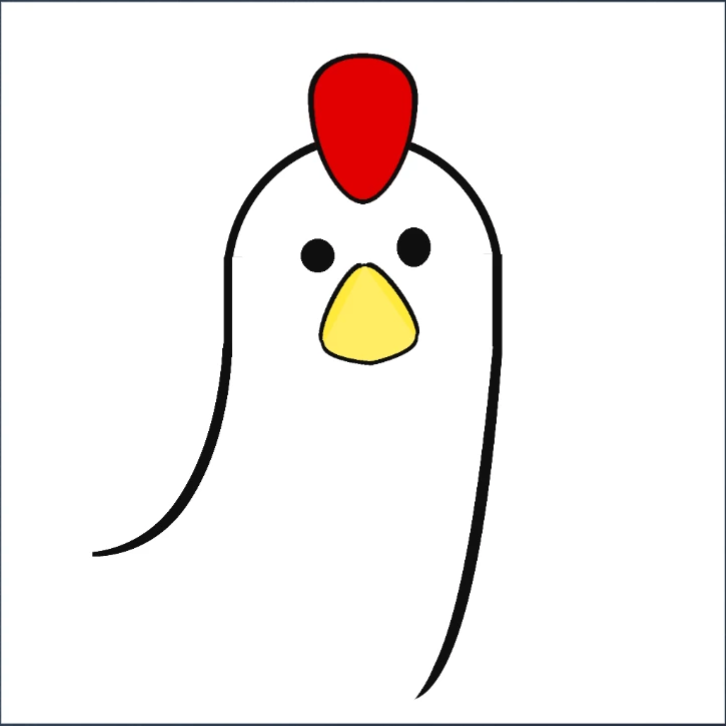

Computer Science undergraduate (Year 3).

Focused on distributed systems, databases and AI.
Daily driver: Linux (Arch).

Tech: Go, C++, Python, Rust, Linux.
Tools: CLI-first workflow, VS Code, Helix.

Interested in system design, networking, and building things from scratch.

<picture>
  <source media="(prefers-color-scheme: dark)" srcset="https://raw.githubusercontent.com/DecarbonizedGlucose/DecarbonizedGlucose/output/pacman-contribution-graph-dark.svg">
  <source media="(prefers-color-scheme: light)" srcset="https://raw.githubusercontent.com/DecarbonizedGlucose/DecarbonizedGlucose/output/pacman-contribution-graph.svg">
  
</picture>

